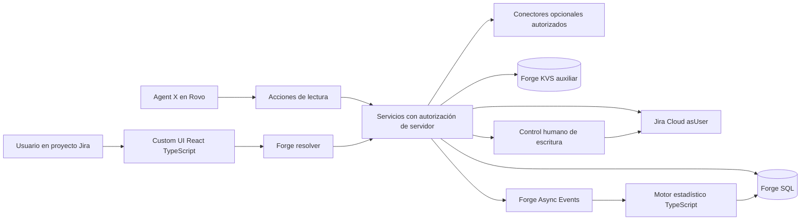

# Arquitectura de implementación

El [plan maestro, §§3–6 y 9](../../CONTROL_TOWER_X_MASTER_PLAN.md) contiene los contratos, el esquema relacional y los límites de autorización. Este mapa indica dónde se verifica cada interfaz.

| Frontera | Responsabilidad | Verificación |
|---|---|---|
| Browser → resolver | DTO, lectura del contexto y autorización en servidor | SDD-001, 003, 004 y 006 |
| Resolver → servicio → fuente | Aislamiento, ACL de origen, cursores, procedencia y manejos de error | SDD-002, 004 y 008 |
| Corrida → consumidor → agregado | Snapshot y semilla, trabajo idempotente, huella inmutable | SDD-005 y 006 |
| Rovo → acciones de lectura | Identidad confiable, permisos, evidencia y límite de origen | SDD-007 |
| Aprobación → Jira | Destino configurado, aprobación humana, `asUser`, auditoría y reconciliación | SDD-009 |

Forge Custom UI se instala en un proyecto de Jira de prueba. Confluence puede configurarse como integración opcional en un mismo sitio cuando se confirme su compatibilidad. JSM, Assets, MCP y Teamwork Graph se habilitan según estado verificado de producto, instalación, licencia y permisos. Las credenciales residen en los mecanismos autorizados descritos en la checklist. El benchmark de Forge define el tamaño final de lote y el presupuesto de demo.

El backend usa infraestructura Forge para código, estado y ejecución del MVP. Las acciones conversacionales consultan resultados calculados y no escriben en Jira. La edición de escenarios y el flujo de aprobación pasan por Custom UI. La interfaz representa estado de fuente, fecha de corte y permisos de forma explícita.

Referencias oficiales. [Custom UI](https://developer.atlassian.com/platform/forge/build-a-custom-ui-app-in-jira/) · [Resolver](https://developer.atlassian.com/platform/forge/runtime-reference/forge-resolver/) · [Forge SQL](https://developer.atlassian.com/platform/forge/storage-reference/sql/) · [Async Events](https://developer.atlassian.com/platform/forge/runtime-reference/async-events-api/) · [Rovo](https://developer.atlassian.com/platform/forge/build-a-jira-issue-analyst-rovo-agent/).
